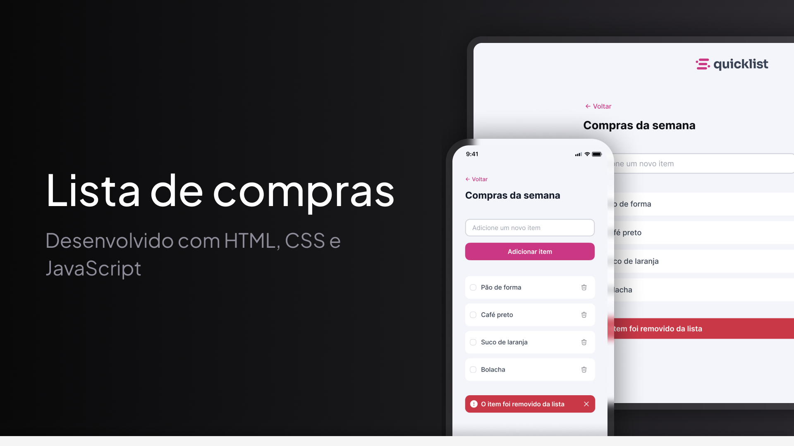

<h1 align="center"> Lista de Compras </h1>

<p align="center">
Aplicação web responsiva para adicionar, selecionar e remover itens de uma lista de compras.<br/>
</p>

<p align="center">
  <a href="#projeto">Projeto</a>&nbsp;&nbsp;&nbsp;|&nbsp;&nbsp;&nbsp;
  <a href="#tecnologias-utilizadas">Tecnologias</a>&nbsp;&nbsp;&nbsp;|&nbsp;&nbsp;&nbsp;
  <a href="#funcionalidades">Funcionalidades</a>&nbsp;&nbsp;&nbsp;|&nbsp;&nbsp;&nbsp;
  <a href="#manipulação-da-lista">Manipulação da lista</a>&nbsp;&nbsp;&nbsp;|&nbsp;&nbsp;&nbsp;
  <a href="#responsividade">Responsividade</a>
</p>

<br>

<p align="center">
  
</p>

## Projeto

A Lista de Compras é uma aplicação web desenvolvida para permitir que o usuário organize os itens de suas compras de forma simples e interativa.

É possível adicionar novos itens à lista, marcar itens como selecionados, remover itens individualmente e limpar toda a lista de compras.

O projeto foi desenvolvido durante os estudos de desenvolvimento Full Stack, com foco na aplicação prática de HTML, CSS e JavaScript.

Além da construção da interface, o desenvolvimento envolveu validação de formulário, criação dinâmica de elementos, manipulação do DOM, eventos de interação e atualização da interface de acordo com o estado da lista.

## Projeto online

- [Acesse o projeto finalizado, online](https://felipe-hendrich.github.io/projeto-lista-de-compras/)

## Tecnologias utilizadas

- HTML
- CSS
- JavaScript
- Git
- GitHub
- Google Fonts

## Funcionalidades

- Adição de novos itens à lista de compras
- Validação para impedir a inclusão de itens vazios
- Seleção de itens por meio de checkbox personalizado
- Alteração visual do checkbox ao passar o mouse
- Alteração visual do checkbox quando o item é selecionado
- Remoção individual de itens
- Exibição de alerta após a remoção de um item
- Botão para fechar manualmente o alerta
- Remoção automática do alerta anterior ao excluir outro item
- Botão para limpar toda a lista de compras
- Exibição do botão de limpar somente quando existem itens na lista
- Ocultação automática do botão quando a lista fica vazia
- Retorno automático do foco para o campo após adicionar um item
- Interface responsiva para diferentes tamanhos de tela

## Validações

Antes de adicionar um novo item, a aplicação verifica o conteúdo informado pelo usuário.

O valor digitado é tratado utilizando o método `trim()`, removendo espaços em branco desnecessários antes da validação.

Caso o campo esteja vazio, o item não é adicionado à lista.

```js
const itemValue = input.value.trim();

if (itemValue === "") {
  return;
}
```

Após a inclusão do item, o campo é limpo e recebe novamente o foco, permitindo que novos itens sejam adicionados de forma mais prática.

## Manipulação da lista

Os itens são criados dinamicamente utilizando JavaScript.

Para cada novo item são criados:

- elemento `li`
- nome do item
- checkbox personalizado
- ícone para remoção

A criação e inserção dos elementos utiliza métodos como:

- `document.createElement()`
- `textContent`
- `classList.add()`
- `append()`

Os itens são adicionados dentro da lista somente após a validação do valor informado pelo usuário.

## Seleção dos itens

Cada item possui um checkbox personalizado que pode assumir diferentes estados visuais.

Os estados utilizados são:

- padrão
- hover
- selecionado

Uma variável booleana controla o estado de seleção de cada item.

Ao clicar no checkbox, o valor é alternado e o ícone correspondente é atualizado.

Também são utilizados os eventos `mouseenter` e `mouseleave` para controlar a aparência do checkbox enquanto o usuário posiciona o cursor sobre o elemento.

## Remoção de itens

Cada item possui um ícone de lixeira responsável pela remoção individual.

Ao clicar no ícone, o elemento correspondente é removido utilizando:

```js
item.remove();
```

Após a remoção, a aplicação verifica novamente a quantidade de elementos presentes na lista para determinar se o botão de limpar a lista deve continuar visível.

## Alerta de remoção

Quando um item é removido, uma mensagem de confirmação é criada dinamicamente e adicionada à página.

O alerta informa:

```text
Item removido da lista
```

Antes de criar um novo alerta, a aplicação verifica se já existe outro sendo exibido.

Caso exista, ele é removido antes da criação da nova mensagem.

O alerta também possui um botão que permite ao usuário fechá-lo manualmente.

## Limpar lista

Além da remoção individual, a aplicação possui um botão para excluir todos os itens da lista de uma única vez.

A limpeza utiliza:

```js
list.replaceChildren();
```

A função `updateRemoveButton()` verifica a quantidade de elementos presentes na lista.

Quando existe pelo menos um item, o botão de limpar é exibido.

Quando a lista fica vazia, o botão é ocultado automaticamente.

## Responsividade

A aplicação foi desenvolvida para se adaptar a diferentes tamanhos de tela.

Foram utilizados Flexbox e media queries para reorganizar os principais elementos da interface.

Em telas menores, o formulário passa a utilizar uma estrutura vertical, permitindo que o campo de texto e o botão ocupem toda a largura disponível.

Também foram ajustados:

- formulário
- campos de entrada
- botões
- lista de compras
- espaçamentos
- largura dos elementos

## Recursos visuais

O projeto utiliza diferentes estados visuais para melhorar a interação com o usuário, incluindo:

- mudança de cor dos botões ao passar o mouse
- alteração da borda do campo de entrada
- destaque do campo quando recebe foco
- checkbox com estado padrão
- checkbox com estado hover
- checkbox selecionado
- alerta visual após a remoção de um item
- layout adaptado para dispositivos móveis

## Estrutura de arquivos

```text
projeto-lista-de-compras/
├── index.html
├── script.js
├── .gitignore
├── README.md
│
├── .github/
│   └── capa-readme.png
│
├── assets/
│   ├── favicon.svg
│   ├── logo.svg
│   │
│   └── icons/
│       ├── alert.svg
│       ├── bin-hover.svg
│       ├── bin.svg
│       ├── checkbox-default.svg
│       ├── checkbox-hover.svg
│       ├── checkbox-select.svg
│       └── remove.svg
│
└── styles/
    ├── global.css
    ├── index.css
    └── style.css
```
